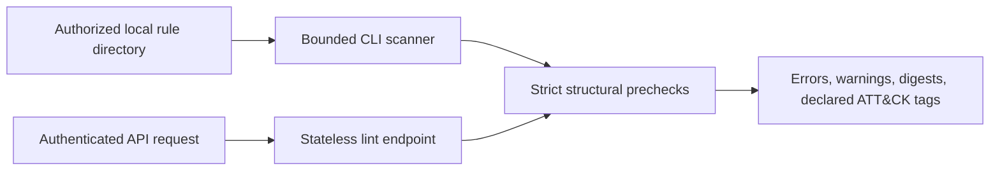

# Architecture and threat model

RuleSmith's first milestone has two paths: an offline CLI scans one explicit local directory, and a FastAPI endpoint checks one submitted rule. Both call the same bounded precheck functions. The API does not accept file paths. There is no operational database or rule deployment component yet, so no migration is applicable. Each `sha256` is computed over the original submitted bytes. A duplicate ID or digest is a review signal, not a reason to overwrite either rule.

| Boundary | Threat | Current control | Next milestone |
| --- | --- | --- | --- |
| Rule files | YAML alias abuse, duplicate keys, malformed input | SafeLoader subclass, no aliases, complexity and byte limits | Fuzz parsing; optional full pySigma validation |
| Filesystem scan | Symlink escape, huge tree, unintended file reads | Explicit root, symlink skip, nofollow file open, depth/entry/file/byte caps | More robust race tests and configurable scan scopes |
| API | Unauthorized lint or server-side path read | 32+ character bearer token, no path endpoint, bounded content | Per-user auth, rate limits, audit when persistence is added |
| Detection engines | Rule execution or deployment | No engine invocation or deployment code | Controlled compiler subprocesses and sandboxing |
| ATT&CK coverage | False confidence from author tags | Field named `declared_attack_tags`; no coverage claim | Analyst evidence review before coverage visualization |

The YARA and Suricata checks are intentionally structural only. They do not prove engine acceptance or detection behavior. The Sigma condition checker verifies a simple named selection and flags complex conditions for pySigma; it never converts or executes them.
